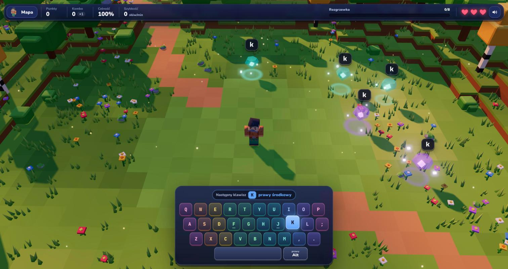

# Literkowo

A typing adventure for kids. Learn to touch type in Polish or English by freeing letters from crystals in a blocky 3D world.



**Play:** https://veelenga.github.io/literkowo/

- 17 levels from `f j` to the Polish letters typed with right Alt, with finger hints before each one
- Five worlds, each ending with a boss, and a short story along the way
- Polish or Ukrainian interface, Polish or English words
- Several player profiles on one device, with stars and progress saved in the browser
- Music and sound effects generated live, no files

## Develop

```
nvm use
npm install
npm run dev
```

`nvm use` picks the Node LTS version from `.nvmrc`. `npm test` runs the unit tests, `npm run lint` checks types and formatting. In development, `?level=polana-1` on the dev URL starts a level directly.

`npm run e2e` builds the game and plays the first level in headless Chromium. Run `npx playwright install chromium` once before the first run.

Contribution rules are in [CLAUDE.md](CLAUDE.md).

## Credits

- Characters: "Blocky Characters" by Kenney (kenney.nl), CC0
- Fonts: Nunito and JetBrains Mono via Fontsource, OFL
